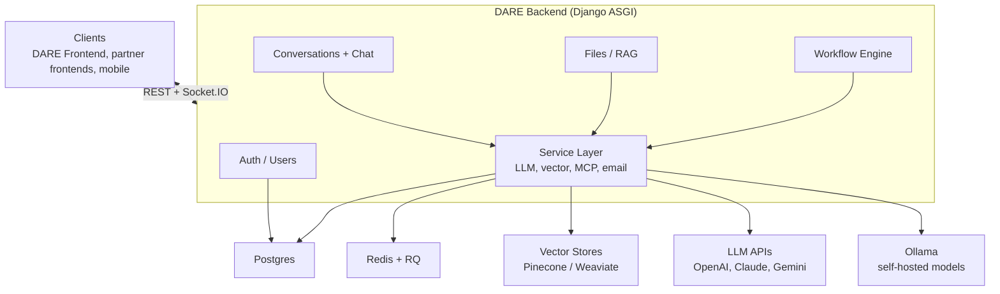

# DARE Backend

[](https://github.com/cmudco/dare-backend/blob/main/LICENSE)
[](https://www.python.org/)

> Django REST + Socket.IO backend for the **Dietrich Analysis Research Education (DARE) Platform**.

## What is DARE?

DARE is an open-source, multi-LLM research and conversation platform. It gives you one
vendor-agnostic interface to OpenAI, Anthropic Claude, Google Gemini and self-hosted LLaMA models,
with file-grounded retrieval (RAG), Model Context Protocol (MCP) tools, visual multi-step
workflows and real-time streaming.

DARE is built for researchers and institutions that need more than a chatbot: document
intelligence, reproducible workflows and per-user usage tracking in one place.

**This repository is the DARE backend**, the Django ASGI service that powers the platform.

> **DARE runs standalone.** The DARE backend and frontend are all you need to run the platform.
> SocraticBooks is a separate, optional platform built on top of DARE.

## Overview



Clients talk to the backend over REST and Socket.IO. Every feature goes through one service layer
that owns the LLM, vector-store, MCP and email integrations. The full diagrams are in
[docs/explanation/architecture.md](https://github.com/cmudco/dare-backend/blob/main/docs/explanation/architecture.md).

## Features

- **Streaming chat.** Real-time chat across every supported provider.
- **Documents and RAG.** Upload, processing and retrieval over Pinecone or Weaviate.
- **Workflows.** Multi-step AI workflows built in a visual DAG builder.
- **Usage and billing.** Token usage tracking and per-user billing.
- **Access codes.** Registration gated by access codes for institutional deployments.
- **Partner platforms.** Inter-service authentication for partners such as SocraticBooks.
- **Document generation.** Typst-rendered documents through
  [quillmark-mcp](https://github.com/tonguetoquill/quillmark-mcp), run as a service in the
  compose stack.

## Quick start

You need Docker with Compose and one LLM provider key. Docker brings up the whole stack: API,
worker, Postgres, Redis, Weaviate and quillmark-mcp.

```bash
git clone --recurse-submodules https://github.com/cmudco/dare-backend.git
cd dare-backend
cp .example.env .env   # set DJANGO_SECRET_KEY, DB_PASSWORD and one provider key
docker compose up --build -d
docker compose exec web python manage.py createsuperuser
docker compose exec web python manage.py collectstatic --noinput   # admin CSS/JS
curl http://localhost:8000/api/health/
```

The API runs at `http://localhost:8000/` and Swagger UI at `http://localhost:8000/api/docs/`.
For local development, `scripts/dev-setup.sh --demo-user` does all of this in one command.

The full walkthrough, including the local-Python path and access codes, is
[docs/tutorials/quickstart.md](https://github.com/cmudco/dare-backend/blob/main/docs/tutorials/quickstart.md).
For servers, see [docs/how-to/deploy.md](https://github.com/cmudco/dare-backend/blob/main/docs/how-to/deploy.md).

## Documentation

| Kind | Doc | What's in it |
| --- | --- | --- |
| Tutorial | [docs/tutorials/quickstart.md](https://github.com/cmudco/dare-backend/blob/main/docs/tutorials/quickstart.md) | Run the backend locally: Docker stack, or local Python in a venv |
| Tutorial | [docs/tutorials/getting-started.md](https://github.com/cmudco/dare-backend/blob/main/docs/tutorials/getting-started.md) | Run the whole DARE platform locally and send a first chat |
| How-to | [docs/how-to/deploy.md](https://github.com/cmudco/dare-backend/blob/main/docs/how-to/deploy.md) | Production deployment, upgrades, rollback |
| How-to | [docs/how-to/administer-dare.md](https://github.com/cmudco/dare-backend/blob/main/docs/how-to/administer-dare.md) | Users, roles, access codes, model groups, analytics |
| Reference | [docs/reference/configuration.md](https://github.com/cmudco/dare-backend/blob/main/docs/reference/configuration.md) | Every environment variable, with default and description |
| Reference | [docs/reference/rest-api.md](https://github.com/cmudco/dare-backend/blob/main/docs/reference/rest-api.md) | REST API reference |
| Reference | [docs/reference/socketio-events.md](https://github.com/cmudco/dare-backend/blob/main/docs/reference/socketio-events.md) | Socket.IO event reference |
| Reference | [docs/reference/socratic-bots-integration.md](https://github.com/cmudco/dare-backend/blob/main/docs/reference/socratic-bots-integration.md) | DARE/Socratic Bots integration contract |
| Explanation | [docs/explanation/architecture.md](https://github.com/cmudco/dare-backend/blob/main/docs/explanation/architecture.md) | Platform and backend architecture |
| Project | [.github/CONTRIBUTING.md](https://github.com/cmudco/dare-backend/blob/main/.github/CONTRIBUTING.md) | How to file issues and open pull requests |
| Project | [docs/reference/rules.md](https://github.com/cmudco/dare-backend/blob/main/docs/reference/rules.md) | Coding rules and project conventions |
| Project | [.github/SECURITY.md](https://github.com/cmudco/dare-backend/blob/main/.github/SECURITY.md) | Vulnerability disclosure |
| Project | [AGENTS.md](https://github.com/cmudco/dare-backend/blob/main/AGENTS.md) | Commands and traps for AI coding agents |
| Project | [BRAND.md](https://github.com/cmudco/dare-backend/blob/main/BRAND.md) | DARE brand guidelines and usage policy |

The full map, including every how-to and explanation, is
[docs/index.md](https://github.com/cmudco/dare-backend/blob/main/docs/index.md). Release history
lives in GitHub Releases and the in-app What's New dialog.

## Tech stack

- **Python 3.13**, Django 5.1, Django REST Framework
- **Django Channels** + python-socketio for real-time streaming
- **Django RQ** + Redis for background jobs
- **PostgreSQL** (production) / SQLite (local dev)
- **Weaviate** and **Pinecone** for vector storage
- **Ollama** for self-hosted LLaMA models

## What is included in this repo?

- Django apps for auth and users, conversations and chat, files and RAG, and the workflow engine
- `core/services/`: the service layer (LLM providers, vector stores, MCP, email)
- `docs/`: architecture, configuration, administration, API reference, deployment and integration guides
- The Docker Compose stack (API, RQ worker, Postgres + pgvector, Redis, Weaviate) and `requirements/`
- `quillmark-mcp/`: the document renderer, vendored as a git submodule

## What is not included in this repo?

- [dare-frontend](https://github.com/cmudco/dare-frontend): the React/TypeScript web client (run it separately)
- [socraticbooks-backend](https://github.com/cmudco/socraticbooks-backend) and
  [socraticbooks-react](https://github.com/cmudco/socraticbooks-react): the SocraticBooks platform,
  which proxies to DARE
- Infrastructure you provide: LLM provider API keys, an Ollama host for self-hosted models, and
  managed Postgres, Redis and vector-store instances in production

## Stay in touch

- **Found a bug or have a feature request?** Open an issue on this repository.
- **Found a security issue?** Follow [.github/SECURITY.md](https://github.com/cmudco/dare-backend/blob/main/.github/SECURITY.md).
- **Questions or general inquiries?** Email the project team at vks@andrew.cmu.edu.

## Acknowledgements

DARE is an Open Forum for AI (OFAI) initiative of Carnegie Mellon University Libraries.

Carnegie Mellon University owns the DARE name and marks. The
[DARE Brand Guidelines & Usage Policy](https://github.com/cmudco/dare-backend/blob/main/BRAND.md)
governs use of the name, wordmark, Scotty dog mark, header lockup and footer badge, independently
of the software license.

DARE integrates with third-party APIs (Anthropic, OpenAI, Google and others). Each provider's
Terms of Service govern your use of its API.

## Contributors

DARE is built and maintained by contributors at Carnegie Mellon University and in the open-source community.

**Creators**

<table>
  <tr>
    <td align="center" valign="top" width="33.33%"><br /><sub><b>Sayeed Choudhury</b></sub><br />Creator</td>
    <td align="center" valign="top" width="33.33%"><br /><sub><b>Vincent Sha</b></sub><br />Creator</td>
    <td align="center" valign="top" width="33.33%"><br /><sub><b>George Cann</b></sub><br />Creator</td>
  </tr>
</table>

**Team**

<table>
  <tr>
    <td align="center" valign="top" width="33.33%"><br /><sub><b>Carl Skipper</b></sub><br />Contributor</td>
    <td align="center" valign="top" width="33.33%"><br /><sub><b>Muhammad Abdurrehman</b></sub><br />Team Lead</td>
    <td align="center" valign="top" width="33.33%"><br /><sub><b>Brian Wingenroth</b></sub><br />Developer</td>
  </tr>
  <tr>
    <td align="center" valign="top" width="33.33%"><br /><sub><b>Farhat Abbas</b></sub><br />Developer</td>
    <td align="center" valign="top" width="33.33%"><br /><sub><b>Hariss M.</b></sub><br />Developer</td>
    <td align="center" valign="top" width="33.33%"><br /><sub><b>Eira Khan</b></sub><br />QA</td>
  </tr>
</table>

## License

DARE is licensed under the [GNU Affero General Public License v3.0](https://github.com/cmudco/dare-backend/blob/main/LICENSE) (AGPL-3.0-only); the full text is in [LICENSE](https://github.com/cmudco/dare-backend/blob/main/LICENSE) and at <https://www.gnu.org/licenses/agpl-3.0.en.html>.
The software license grants no rights to the DARE name or marks; see the
[DARE Brand Guidelines & Usage Policy](https://github.com/cmudco/dare-backend/blob/main/BRAND.md).
