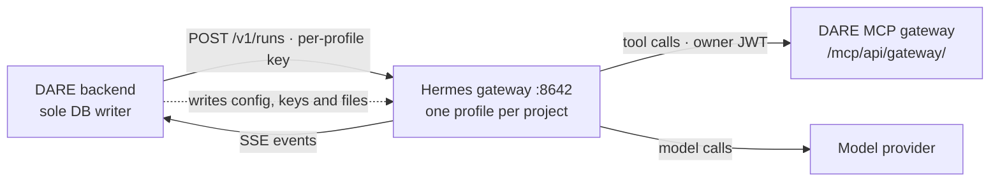

# Research Mode on Hermes

Research Mode runs its agents (the research chat, Scouts, the Critic and the
Presenter) on **Hermes Agent** over its REST API. DARE owns the record; Hermes
runs the agent loop and never touches the database.



Tested on **Hermes v0.21.7** with the DARE tool-call patch (§2.2).

---

## 1. What a run is sent

`research/services/prompt_builder.py` builds everything an agent sees. Each
piece of context reaches the run by exactly one route:

| Route | Contents | Built by |
|---|---|---|
| Profile files, loaded by Hermes on every run | `SOUL.md` (persona and standards), `memories/MEMORY.md` (a Project section, then approved project memory), `memories/USER.md` (approved memory about the user), `skills/dare/*/SKILL.md` (approved procedures) | `profile_files(project)` |
| `instructions` | The role's brief and the run's handle for DARE's tools | `chat_prompt`, `scout_prompt`, `critic_prompt`, `artifact_prompt` |
| `conversation_history` | A chat thread's earlier turns, workspace events included | `conversation_history` |
| `input` | What the run acts on now: the user's message, the events a follow-up answers, a Scout's task | the same builders |

The Project section (title, question, kind of question and which sources count)
is DARE's first entry in `MEMORY.md`, written from the project's settings.
History stops where the input starts, so a message or an event is never sent
twice.

`research/services/run_service.start` writes the profile files, saves what the
run is sent on `ResearchAgentRun.prompt`, and starts it. `GET
/api/research/agent-runs/{id}/` returns that record, and `GET
/api/research/projects/{id}/agent-memory/` shows the files a project's next run
will load.

## 2. The Hermes host

### 2.1 Install and enable the API server

```bash
curl -fsSL https://hermes-agent.nousresearch.com/install.sh | sh
```

In `~/.hermes/config.yaml`:

```yaml
gateway:
  multiplex_profiles: true
```

In `~/.hermes/.env`:

```bash
API_SERVER_ENABLED=true
API_SERVER_KEY=<random, at least 16 characters>
```

The listener needs `API_SERVER_KEY` to bind (a shorter key makes the gateway
exit on start). DARE never uses it: each project profile has its own key (§4).
Keep the API on loopback, or behind TLS and a network policy.

The default profile is still reachable with the listener key, so strip its host
tools:

```bash
hermes tools disable --platform api_server \
  terminal code_execution file browser delegation cronjob image_gen
```

### 2.2 Apply the tool-call patch (required)

The run audit joins each streamed tool call to the gateway's record of it by a
shared id. Stock Hermes sends none, so apply the patch after every install or
upgrade:

```bash
cd ~/.hermes/hermes-agent
git apply /path/to/dare-backend/ops/hermes/0002-dare-toolcall-correlation-v0.21.7.patch
hermes gateway restart
```

Its three hunks put `tool_call_id` on `tool.completed` (`agent/tool_executor.py`),
`toolCallId` on the streamed event (`gateway/platforms/api_server_runs.py`) and
`_meta.dareCall` on MCP calls (`tools/mcp_tool_handlers.py`). Without it the
audit falls back to matching by order and loses results for re-read pages and
parallel calls; `research.audit` warnings in the worker log say when that
happens.

### 2.3 Start the gateway

```bash
hermes gateway install && hermes gateway start
```

## 3. DARE settings

```bash
HERMES_GATEWAY_URL=http://127.0.0.1:8642
HERMES_PROFILES_ROOT=/home/<user>/.hermes/profiles
HERMES_PROFILE_MODEL=claude-sonnet-5          # pinned into every profile
HERMES_PROFILE_MODEL_PROVIDER=anthropic
# Or route every profile through an OpenAI-compatible gateway (e.g. LiteLLM);
# the key is written into each profile's own .env:
# HERMES_PROFILE_MODEL=gpt-6-luna
# HERMES_PROFILE_MODEL_BASE_URL=https://ai-gateway.example.edu/v1
# HERMES_PROFILE_MODEL_API_KEY=sk-...
DARE_MCP_GATEWAY_URL=http://127.0.0.1:8000/mcp/api/gateway/
RESEARCH_PROJECT_SPEND_CAP_USD=0              # per project; 0 = no cap
OPENALEX_MAILTO=ops@example.edu               # OpenAlex polite pool
```

Defaults that rarely change: `HERMES_PROFILE_PREFIX` (`dare-proj`),
`HERMES_PROFILE_MAX_TURNS` (30), `HERMES_PROFILE_TOKEN_DAYS` (365),
`HERMES_STREAM_IDLE_SECONDS` (180), `HERMES_RUN_WAIT_SECONDS` (1800),
`HERMES_PROFILE_FALLBACK_MODELS` (none).

- **Never set a provider without a model.** Hermes would fall through to that
  provider's flagship; DARE raises `ImproperlyConfigured` instead.
- **`DARE_MCP_GATEWAY_URL` is resolved by the Hermes host,** because it is
  written into each profile's `config.yaml`.

Run migrations, then the stack: `uvicorn dare.asgi:application`, Redis, and RQ
workers on the `default` queue (`--worker-class rq.SimpleWorker` on macOS).
Redis is also the shared cache across ASGI workers; never call `cache.clear()`.

## 4. What DARE writes into each profile

`profile_service.ensure_project_profile` runs before every use, and a project's
profile is created when the project is.

| File | Contents |
|---|---|
| `config.yaml` | Pinned model, `max_turns`, toolsets `memory, skills, todo, vision`, `tool_search` off, write approval on for memory and skills, the `dare` MCP server |
| `.env` | `API_SERVER_KEY` (derived from `SECRET_KEY` and the project id), `MCP_DARE_API_KEY` (the owner's JWT, re-minted when stale), `DARE_MODEL_API_KEY` |
| `SOUL.md`, `memories/*.md`, `skills/dare/` | Rendered from DARE's approved state (§1) |

A new profile gets a warm-up run so its MCP tools are connected before the first
real turn. Profiles of deleted projects keep retrying with dead tokens and slow
the gateway's start; remove their directories.

Confirm routing and isolation (the listener key must be refused):

```bash
KEY=$(grep '^API_SERVER_KEY=' ~/.hermes/profiles/dare-proj1/.env | cut -d= -f2-)
curl -s -o /dev/null -w '%{http_code}\n' -H "Authorization: Bearer $KEY" \
  http://127.0.0.1:8642/p/dare-proj1/v1/models          # 200
curl -s -o /dev/null -w '%{http_code}\n' -H "Authorization: Bearer $API_SERVER_KEY" \
  http://127.0.0.1:8642/p/dare-proj1/v1/models          # 401
```

`python ops/hermes/verify_multiplex.py` checks routing, model pinning and
isolation end to end.

## 5. Tools

The live gateway exposes DARE's own tools only: `web_search`, `search_papers`,
`fetch_page`, the thread tools (`launch_scouts`, `thread_status`,
`search_threads`, `search_knowledge`) and the Scout tools (`stage_finding`,
`report_learning`). Thread and Scout tools are authorized by a signed token in
their arguments. The user's credentialed tools (Scite, Consensus) are never
exposed: DARE runs them server-side for each Scout and puts the results in its
input.

A page that cannot be read (paywall, 404) is a normal reply, not an MCP error,
so dead links do not trip Hermes's per-server circuit breaker.

## 6. Memory and learning

| File | Source of truth | Reaches |
|---|---|---|
| `SOUL.md` | `SoulFileVersion` (versioned) | this project |
| `memories/MEMORY.md` | the project's settings + `ResearchProjectMemory` | this project |
| `memories/USER.md` | `ResearcherProfile` | every project the user owns |
| `skills/dare/<name>/SKILL.md` | `ResearchProcedure` | every project, or one |

Every memory or skill write the agent makes, mid-turn or in background
reflection, is staged under `<profile>/pending/`. DARE turns each into a
`ResearchMemoryProposal` (`learning_service.sync_pending_learning`), the user
approves or rejects it, and DARE re-renders the files. Hermes caps
`MEMORY.md` (2200 chars) and `USER.md` (1375 chars) and rejects writes past
the cap. External memory providers stay off: they ingest every turn, leaving
nothing to review.

## 7. Cost and source checks

| Layer | Knob | Default |
|---|---|---|
| Agent loop | `HERMES_PROFILE_MAX_TURNS` | 30 |
| Scout depth | `SCOUT_LIMITS` in `research/constants.py`, enforced at the gateway | quick 2 searches / 3 reads, deep 5 / 10 |
| Page reads | `PAGE_PIECE_CHARS` per `fetch_page` call | 12k chars |
| Project budget | `RESEARCH_PROJECT_SPEND_CAP_USD` | off |

Runs are priced from DARE's `LLM` rate table, with cached input at the cached
rate. Every `stage_finding` is checked first (`source_check.py`): dead links
and DOIs for a different paper are refused; a missing quote, a retraction or
data older than the project kind allows is staged with a flag.

## 8. Smoke test

1. Create a project in the UI; `~/.hermes/profiles/dare-proj<id>/` appears with
   `config.yaml`, `.env`, `SOUL.md` and `memories/`.
2. In a new thread ask "What is the question we are working on?" and "What do
   you know about me?". The answers come from `MEMORY.md` and `USER.md`.
3. Open the run (`GET /api/research/agent-runs/{id}/`): `prompt.files` shows
   the files it loaded, and neither `prompt.instructions` nor `prompt.input`
   repeats them.
4. Launch a Scout; findings land in the Review Inbox and the thread gets a
   follow-up answer.

## 9. Known limitations

- Structured replies (Critic verdict, artifact metadata) are a prompt contract
  plus tolerant parsing; Hermes has no schema forcing.
- Approved learning reaches other profiles by re-rendering; a profile that
  cannot be written keeps its old files until its next run.
