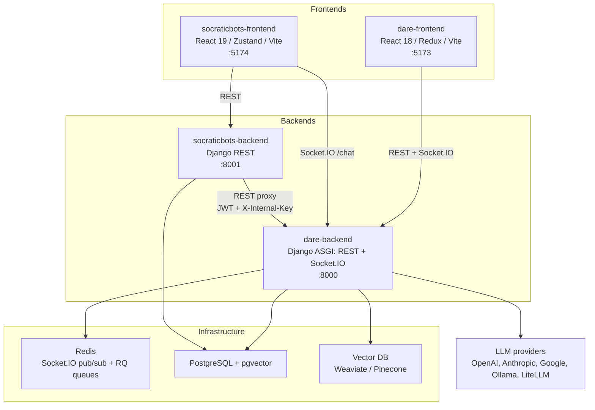
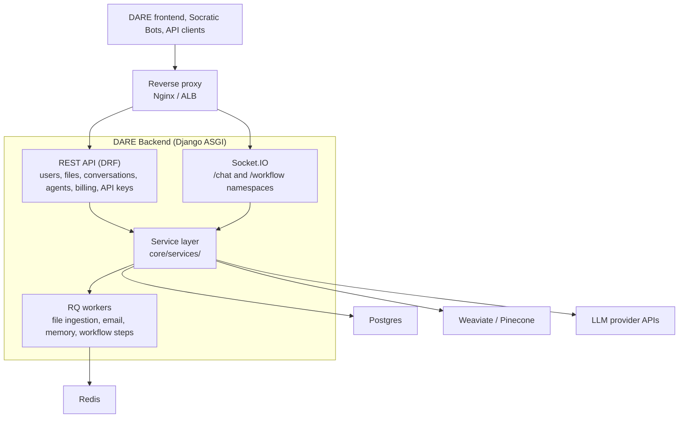
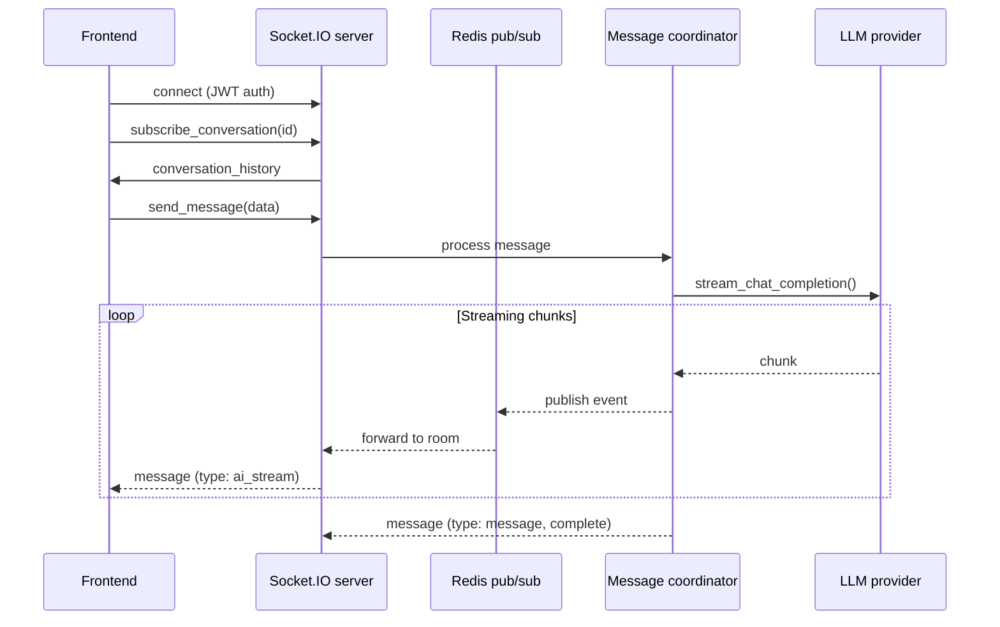
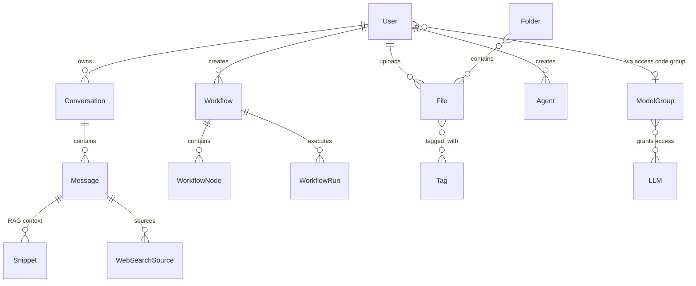

# DARE Backend — Architecture

How the backend is put together and why. For request-by-request sequence diagrams see
[data-flows.md](data-flows.md); for event payloads see
[the Socket.IO reference](../reference/socketio-events.md).

## The platform

DARE is one backend serving two products: the DARE app and Socratic Bots.



- **dare-backend** owns accounts, conversations, files and RAG, LLM calls, billing, workflows,
  MCP, memory and research mode.
- **socraticbots-backend** stores the teaching layer (tutors, access codes, notes, voice agents)
  and proxies everything else to DARE. It has no LLM or vector code.
- **socraticbots-frontend** talks REST to its own backend, but chats directly on DARE's `/chat`
  socket, sending the tutor's settings as `bot_meta`. See
  [Socratic Bots integration](../reference/socratic-bots-integration.md).

## Inside the backend



| Component | Responsibility | Code path |
|---|---|---|
| **REST API** | CRUD over conversations, files, prompts, users, billing | `*/views.py`, `*/serializers.py`, `*/urls.py` (some apps use `<app>/api/`) |
| **Socket.IO server** | Chat streaming and workflow execution updates | `conversations/socket_server.py` and `conversations/namespaces/`, mounted in `dare/asgi.py`; `workflows/` |
| **Service layer** | Provider integrations and multi-model coordination | `core/services/` |
| **Background workers** | File processing, embeddings, email, memory writes | `*/tasks.py`, run by `python manage.py rqworker` |
| **Models** | Domain data | `*/models.py`; mixins in `common/models.py` |
| **Settings** | `common` → `local` / `staging` / `production` | `config/settings/`, `config/env.py` |

A plain REST request goes: client → reverse proxy → Uvicorn → Django middleware → DRF JWT
authentication → view → serializer → model → Postgres → response.

## Architectural choices

- **python-socketio, not Django Channels consumers.** The Socket.IO app is mounted next to Django
  in `dare/asgi.py` and uses a Redis-backed manager, so events reach a room from any process.
  This is why the backend must run under an ASGI server (Uvicorn); `runserver` cannot serve it.
- **Service layer over fat models.** Models stay thin. Logic that touches a third party or
  coordinates several models lives in `core/services/`.
- **One dispatch point per provider family.** `LLMService` in `core/services/llm_service.py`
  picks the provider class for a model; `get_vector_service()` in
  `core/services/vector_service.py` picks the vector store:

  ```
  LLMService → AIService implementation
      ├── OpenAIService
      ├── ClaudeService
      ├── GeminiService
      ├── LlamaService       (Ollama)
      └── CustomLLMService   (custom endpoints and LiteLLM proxies)

  get_vector_service() → BaseVectorService implementation
      ├── WeaviateVectorService
      └── PineconeVectorService
  ```

- **Chat is a bounded tool loop.** A turn streams, calls tools, reads their results and streams
  again. See [tool-loop.md](tool-loop.md).
- **Soft deletes and filtered managers.** `BaseModel` adds `is_active` and `is_deleted`. Most
  models declare only `active_objects`, which hides retired rows, and there is no `objects`
  manager on them; reverse relations filter the same way. Use `_base_manager` to see every row.
- **Slow work goes to RQ.** File ingestion, embeddings and memory writes run in workers so the
  web process stays responsive. Each job must be safe to retry (`rules.md`, section 7).
- **camelCase at the boundary.** REST and socket payloads are camelCase; Python stays snake_case.
  See [serialization.md](../reference/serialization.md).

## Real-time chat



Two namespaces:
- `/chat`: conversations, messages, artifacts, voice input.
- `/workflow`: workflow execution, step streaming, batch processing, human validation.

## Key relationships



## Further reading

- [data-flows.md](data-flows.md): chat, file upload, workflow, Socratic Bots auth and artifact
  sequences.
- [document-ingestion.md](document-ingestion.md): how an upload becomes a verified search index.
- [tool-loop.md](tool-loop.md): tool calling across providers.
- [REST API](../reference/rest-api.md) and [Socket.IO events](../reference/socketio-events.md).
