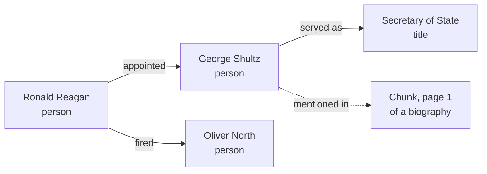
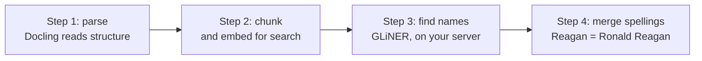
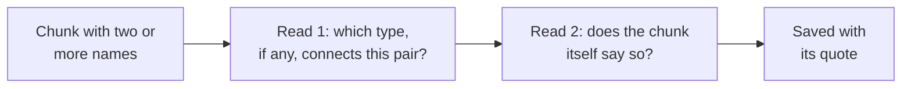
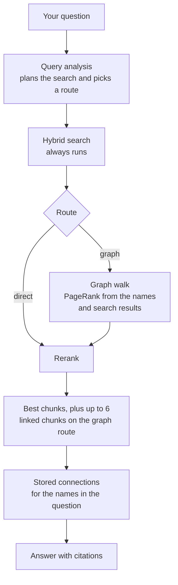

# Graph RAG in DARE

Search finds chunks that look like the question. It struggles when the answer is spread across
documents and the only link between them is a name: a person, a place, or an organization. Graph RAG
adds that link. It maps which names appear in which chunks, then follows those connections to find
evidence that search alone would miss.

DARE follows a published method called HippoRAG. It runs on the documents and database DARE already
has. The only part that costs extra is optional and needs your approval.

## Words used here

| Word | Meaning |
|---|---|
| **Chunk** | A small piece of a document. Search works on chunks. Research papers call them "passages" |
| **Entity** | A name in the text: a person, organization, place, or title |
| **Alias** | Another spelling of the same entity: "Reagan" and "Ronald Reagan" |
| **Node and edge** | A thing, and a connection between two things |
| **Mentioned together** | Two entities appear in the same chunk. This makes no claim about how they relate |
| **Stated relationship** | A fact a chunk says: "Reagan fired Oliver North" |
| **Query analysis** | The first step of Advanced RAG. A small model call reads the question and plans the search |
| **Hybrid search** | Keyword search and meaning search combined |
| **Graph walk** | PageRank run over the graph, starting from the question |

## 1. What a graph is

A graph has two parts: **nodes** (things) and **edges** (how they connect).

Facebook's social graph is the classic example. Its data store, TAO, describes everything as
*objects* (a person, a post, a place) and *associations* (links such as "likes" or "is friends
with"). It handles a billion reads per second, on top of MySQL. So a graph is a way of modelling
data. It doesn't have to mean a dedicated graph database like Neo4j.

DARE uses the same model for documents:



Every edge points back to the chunk it came from, so you can check it.

## 2. What HippoRAG is

**Graph RAG is the family:** any RAG that uses a graph. Microsoft's product called GraphRAG is one
member, and so is HippoRAG. "Graph RAG" is like "smartphone," and these are specific phones.

HippoRAG comes down to four steps:

1. Find the entities in every chunk.
2. Link each entity to the chunks that mention it.
3. Join other spellings of the same name.
4. For each question, start at the names it mentions and spread score along the links. The chunks
   that collect the most score become evidence.

Step 4 is **Personalized PageRank**. Google's PageRank says a page matters if important pages link
to it. The personalized version adds a rule: at each step, half the score keeps moving and half
returns to the starting points, so results stay close to the question.

Say a question names Reagan. Score flows to the chunks that mention Reagan, then to other names in
those chunks, then to their chunks. A chunk reached by several routes scores high, even if its
wording looks nothing like the question.

Among other changes, HippoRAG 2 made chunks full nodes in the graph and search results starting
points too. DARE follows that part of its design.

## 3. What the research says

| Work | Main idea | What we took |
|---|---|---|
| [GraphRAG](https://arxiv.org/abs/2404.16130) (Microsoft, 2024) | An LLM builds the graph, then summarizes groups of related entities | The problem it defines. We did not build group summaries |
| [HippoRAG](https://arxiv.org/abs/2405.14831) (NeurIPS 2024) | The four steps above | **Our baseline** |
| [HippoRAG 2](https://arxiv.org/abs/2502.14802) (2025) | Chunks in the graph, search results as starting points | **Our walk design** |
| [LazyGraphRAG](https://www.microsoft.com/en-us/research/blog/lazygraphrag-setting-a-new-standard-for-quality-and-cost/) (Microsoft, 2024) | Skip paid extraction at upload, for 0.1% of the indexing cost | Keep the base graph free, and make relationships optional |
| [RAG vs. GraphRAG](https://arxiv.org/abs/2502.11371) (Han et al.) | Neither always wins, so route questions or combine both | Query analysis picks the route |
| [When to use graphs in RAG](https://arxiv.org/abs/2506.05690) | Basic RAG matches or beats graphs on simple facts; graphs help on complex reasoning | Simple questions skip the graph |

Han et al. put the main finding in one line: "RAG and GraphRAG exhibit complementary behaviors
rather than a consistent winner." That's why DARE adds the graph to search and doesn't replace it.

### What's new in 2026

Checked on 6 November 2026. No single method has replaced HippoRAG 2, but it's now the baseline that
new work has to beat. Most of these numbers come from each method's own authors, so they can't be
compared across papers. **We haven't built or run any of these.**

| Work | Finding | Where it would fit in DARE |
|---|---|---|
| [LinearRAG](https://arxiv.org/abs/2510.10114) (reported for ICLR 2026) | A graph with no relation extraction, using PageRank to score chunks, reports 70.2% accuracy on a multi-hop benchmark against 62.7% for HippoRAG 2 and 48.6% for plain RAG | **Upload and walk.** Same idea as our free base graph, and it adds sentence-level links. It's the first upgrade to test on our own questions |
| [Do We Still Need GraphRAG?](https://arxiv.org/abs/2604.09666) (April) | Agents searching plain RAG "can partially compensate," but "explicit graph-based retrieval remains crucial for robust multi-hop reasoning" | **No change.** Graphs still matter when an agent is searching |
| [EHRAG](https://arxiv.org/abs/2604.17458) (April) | Local name extraction, entity clusters, and PageRank report beating HippoRAG 2 on three multi-hop benchmarks | **Upload and walk.** The closest recent design to ours (see below) |
| [GraphRAG-Router](https://arxiv.org/abs/2604.16401) (March) | Learned routing cuts overuse of large models by nearly 30% | **Query analysis.** Our route is one field in an existing call, and this would learn it instead |
| [CatRAG](https://aclanthology.org/2026.findings-acl.290/) (ACL 2026 Findings) | Edge weights fixed at indexing ignore the question, so walks drift toward heavily connected entities | **Walk. Applies to DARE,** because our weights are fixed too. It would adjust them for each question |
| [FlowRAG](https://arxiv.org/abs/2606.17856) (June) | Replaces PageRank with a directed flow and reports gains, using paid chunk summaries | **Walk and upload.** Replaces our walk and adds a paid upload step |
| [ArcRAG](https://arxiv.org/abs/2611.06481) (November) | An agent writes graph queries | **Walk.** Too new to judge |

### An open-source design close to ours

[EHRAG's code](https://github.com/yfsong00/EHRAG) is public, so we read it and compared it with ours.
It supports our main choices. We haven't run it.

| | EHRAG | DARE |
|---|---|---|
| Nodes | Chunks and entities, plus sentences and concept clusters | Chunks and entities |
| Finding names | spaCy, a local model | GLiNER, a local model |
| Paid LLM reads at upload | None | None, unless you approve relationships |
| Walk | Personalized PageRank, 0.5 | Personalized PageRank, 0.5 |
| Chunk starting weight | 0.1 × score | 0.05 × score |
| Grouping names | Related names, by embedding similarity | Other spellings, by rules plus a model check, and you can undo them |
| Stored in | Its own files | Postgres, beside your documents |
| Stated relationships, routing, citations, per-user data | No | Yes |

The whole project is about 1,060 lines of Python. It's research code, and we found no license file,
so it's a useful reference but not something to ship.

## 4. How DARE maps to the baseline

| HippoRAG 2 | DARE | Same or different |
|---|---|---|
| Chunks and entities are nodes | Chunks and entities are nodes | Same |
| Personalized PageRank, 0.5 | Personalized PageRank, 0.5, using `networkx` | Same |
| Starts from entities in the facts that match the question, and from search results at 0.05 × score | Starts from the names in the question, and from search results at 0.05 × score | Same idea, no fact extraction needed |
| An LLM extracts names from every chunk | GLiNER, a [small local model](https://arxiv.org/abs/2311.08526), at no per-document charge | Different, cheaper |
| Links similar names with extra edges | Merges them into one entity by rules, with a model check on unclear pairs | Different. You can see and undo every merge |
| An LLM extracts facts from every chunk | Facts are optional, use a list of types you control, and need your approval | Different, your choice |
| An extra LLM call filters facts on each question | No extra call. Query analysis picks the route | Different, cheaper |

## 5. Why we built on DARE and didn't adopt a library

A library would have been a faster start. We compared them, kept the algorithm, and dropped the
framework.

**The core is small.** Thanks to Docling, DARE already had chunks, pages, and headings for every
document. The walk is one call to a well-known package, and the graph is ordinary database rows.

**A library keeps a second copy of everything.** LightRAG, for example, splits text its own way and
stores chunks, vectors, and its graph in its own storage. The [HippoRAG
library](https://github.com/OSU-NLP-Group/HippoRAG) keeps its index in its own folder. If a user
deleted a file in DARE, we'd have to delete it there too. The same goes for permissions, citations,
and account export.

**Libraries pay an LLM at upload.** The HippoRAG 2 paper measured the text three libraries sent to
an LLM to index the same benchmark:

| Library | Tokens sent to an LLM at indexing |
|---|---|
| Microsoft GraphRAG | 115.5M |
| LightRAG | 68.5M |
| HippoRAG 2 | 9.2M |
| DARE's base graph | 0 |

We still use libraries where they fit: `networkx` and `scipy` for PageRank, GLiNER for names, and
[Docling](https://arxiv.org/abs/2408.09869) for parsing.

## 6. What happens when you upload a file



All four steps run automatically, and the user does nothing more. Steps 3 and 4 add no model charge.
GLiNER does use server memory: about 1.7 GB on our test machine once loaded.

The merge step only joins names that are clearly the same. A surname shared by two people stays
apart, and **Separate** undoes any merge for good.

**Creating a graph** means choosing which files belong together. You can then explore their entities
and see which ones are mentioned together.

**Stated relationships are the optional paid step.** A model suggests up to 12 relationship types
from about 200 chunks spread across your files, plus an optional note on what you want to learn. You
can edit the list. DARE shows the number of chunks, the pairs to check, and the estimated cost before
anything runs. Generic names like "legislation" are skipped. Each chunk with two or more names nearby
is then read twice:



A rerun builds the new relationships first and swaps them in at the end, so a failed run keeps what
you already have. The read also lists acts it saw that no type covers. If you add one, you can pay to
read just the new types.

Both reads use the OpenAI Decisions API. The second asks about the chunk only, to keep outside
knowledge out. Without an OpenAI key, this step is off and everything else still works.

## 7. What happens when you ask a question



The route only decides what's added. Search and reranking always run. Query analysis reads the
question together with the last four turns, so "she" or "that attorney" resolves to a name. It
returns this
(shortened from a real question):

```json
{
  "intent": "exploratory",
  "keywords": ["Haig", "Secretary", "State", "Nixon", "Iran-Contra"],
  "rewritten_query": "Identify who replaced Alexander Haig as U.S. Secretary of State...",
  "hyde_passage": "George P. Shultz replaced Alexander Haig... (a guessed answer, used for search)",
  "route": "graph",
  "query_entities": ["Alexander Haig", "Richard Nixon"]
}
```

The walk only covers the files selected for that question. It took about a second on a graph of 3,800 chunks. An
entity linked to many chunks passes on little to each, so rare connections count for more. Linked
chunks never replace direct search results, and each one shows the path that reached it.

If search already found every chunk the walk can reach, the trace shows **no new chunks**. Small
selections do this often.

**Stored connections reach the model on both routes.** When the selected files have stated
relationships, the ones about the names in the question are added to the context as a short list:
those joining two asked names first, then those about one name, then one step further. Each line
names its file and page. The list is capped, and the model is told it is incomplete, so a missing
line never counts as "false". The trace shows how many were given.

If the graph step fails, the answer still uses the search results and the trace records the error.

### Where the graph lives

In Postgres, as ordinary rows beside your documents: which entity appears in which chunk, which
spellings belong together, and which relationships were stated. For each routed question, DARE reads
the rows for the selected files, builds the graph in memory, walks it, and discards it. There's no
graph database to run. Once stated relationships are built, chat uses them whenever those files are
selected.

## 8. Costs

| Step | When it runs | Cost |
|---|---|---|
| Parse, chunk, and embed | Every upload | The normal embedding charge |
| Find names, merge obvious spellings | Every upload | No model charge. Uses server memory |
| Graph walk | Each question on the graph route | Free, on your server |
| Suggest relationship types | When you click | About $0.01 on our test graph |
| Build stated relationships | Only after you approve | About $0.49 for 10 long articles and 739 chunks |
| Read one added type | Only after you approve | About $0.13 on the same graph |

## 9. How we tested it

We asked the same questions with known answers four ways, and counted an answer as correct only if
it contained the expected facts. Every setup uses Advanced RAG search and reranking.

| Setup | Political history: correct answers (of 16) | Right documents found | Anime: correct answers (of 10) | Right documents found |
|---|---|---|---|---|
| No graph, 4 chunks | 13 | 11 | 8 | 6 |
| No graph, 10 chunks | 15 | 15 | 8 | 7 |
| One-hop link, 4 chunks | 14 | 11 | 8 | 6 |
| **Graph walk, 4 chunks plus up to 6** | **16** | 14 | **9** | **10** |

**One-hop** is DARE's earlier version. From a chunk search found, it jumps once to a chunk that shares
an exact name. The **graph walk** spreads over several steps, understands other spellings, and scores
everything it reaches.

**This doesn't prove the graph is better.** We wrote the questions ourselves and there are only 26
of them. On political history, plain search with more chunks came within one answer and found
slightly more of the right documents. The gain that matters here is the visible path behind each
chunk, together with the anime document results.

## 10. Known limits

- **Stated relationships can be wrong.** A stronger model graded all 134 rows on our midterms graph
  and passed 117. Confidence didn't predict the errors, so the page leads with the quote. Read it.
- **Name-heavy documents work best.** Graphs from concept-heavy material, such as programming
  notes, came out weak in our tests.
- **Broad questions see only the chunks retrieved.** "What are the themes?" gets an answer from those
  chunks, not from the whole collection. We didn't build group summaries.
- **A connection may be only a shared name.** When a question asks how A and B connect and they
  never share a chunk, DARE finds the rarest names beside both and tells the model to say the link
  is only that.
- **Walk weights don't change with the question.** Recent research (CatRAG) shows this can pull a
  walk toward heavily connected entities. Our walk reduces that effect but doesn't remove it.
- **Finding names needs server memory.** Plan for about 1.7 GB per process that loads GLiNER.
- **Exports don't include graphs yet.** Account export and restore don't carry the graph tables.
- **Simple questions skip the walk.** They still get the stored connections for the names they
  mention.

## References

1. Bronson et al., [TAO: Facebook's Distributed Data Store for the Social Graph](https://www.usenix.org/conference/atc13/technical-sessions/presentation/bronson), USENIX ATC 2013.
2. Edge et al., [From Local to Global: A Graph RAG Approach to Query-Focused Summarization](https://arxiv.org/abs/2404.16130), 2024.
3. Gutiérrez et al., [HippoRAG: Neurobiologically Inspired Long-Term Memory for Large Language Models](https://arxiv.org/abs/2405.14831), NeurIPS 2024.
4. Gutiérrez et al., [From RAG to Memory: Non-Parametric Continual Learning for Large Language Models](https://arxiv.org/abs/2502.14802), 2025.
5. Han et al., [RAG vs. GraphRAG: A Systematic Evaluation and Key Insights](https://arxiv.org/abs/2502.11371), 2025, revised 2026.
6. [When to use Graphs in RAG: A Comprehensive Analysis for Graph Retrieval-Augmented Generation](https://arxiv.org/abs/2506.05690), 2025, revised 2026.
7. Microsoft Research, [LazyGraphRAG: Setting a New Standard for Quality and Cost](https://www.microsoft.com/en-us/research/blog/lazygraphrag-setting-a-new-standard-for-quality-and-cost/), 2024.
8. Urchade Zaratiana et al., [GLiNER: Generalist Model for Named Entity Recognition using Bidirectional Transformer](https://arxiv.org/abs/2311.08526), 2023.
9. [Docling Technical Report](https://arxiv.org/abs/2408.09869), 2024.
10. Zhuang et al., [LinearRAG: Linear Graph Retrieval Augmented Generation on Large-scale Corpora](https://arxiv.org/abs/2510.10114), 2025.
11. Fan et al., [Do We Still Need GraphRAG? Benchmarking RAG and GraphRAG for Agentic Search Systems](https://arxiv.org/abs/2604.09666), 2026.
12. Song et al., [EHRAG: Bridging Semantic Gaps in Lightweight GraphRAG via Hybrid Hypergraph Construction and Retrieval](https://arxiv.org/abs/2604.17458), 2026.
13. Fan et al., [GraphRAG-Router: Learning Cost-Efficient Routing over GraphRAGs and LLMs with Reinforcement Learning](https://arxiv.org/abs/2604.16401), 2026.
14. Lau et al., [Breaking the Static Graph: Context-Aware Traversal for Graph-Based RAG](https://aclanthology.org/2026.findings-acl.290/), Findings of ACL 2026.
15. Zhan et al., [FlowRAG: Synergizing Explicit Reasoning via Frequency-Aware Multi-Granularity Graph Flow](https://arxiv.org/abs/2606.17856), 2026.
16. Goel et al., [ArcRAG: Agentic Compositional Retrieval over Knowledge Graphs](https://arxiv.org/abs/2611.06481), 2026.
