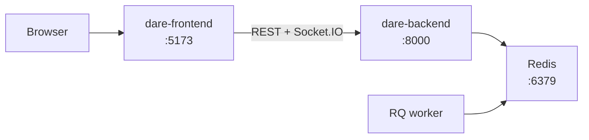

# Getting started

Run the whole DARE platform on your machine (backend, background worker, and frontend), create
an account, and send a first chat message. It takes about 20 minutes on a fresh machine.

For the backend alone, the [quick start](quickstart.md) is shorter. For Socratic Bots, finish
this tutorial first, then follow the Socratic Bots backend's `docs/tutorials/quickstart.md`.

## What you will run



## Prerequisites

| Tool | Version | Notes |
|---|---|---|
| Python | 3.13.x | 3.12 and 3.14 fail to install the dependency set |
| Node.js | 18+ | For the frontend |
| Redis | 6+ | Socket.IO pub/sub and the background job queue |
| An LLM provider key | — | OpenAI, Anthropic, or Gemini |

Clone both repos side by side:

```bash
git clone --recurse-submodules https://github.com/cmudco/dare-backend.git
git clone https://github.com/cmudco/dare-frontend.git
```

## 1. Start Redis

```bash
redis-server
```

Leave it running.

## 2. Start the backend

```bash
cd dare-backend
cp .example.env .env
```

Edit `.env`: set `DJANGO_SECRET_KEY` to any long random string and add one provider key
(`OPENAI_API_KEY`, `CLAUDE_API_KEY`, or `GEMINI_API_KEY`). Every variable is in
[configuration.md](../reference/configuration.md).

```bash
python3.13 -m venv .venv && source .venv/bin/activate
pip install -r requirements/local.txt
python manage.py migrate
python manage.py createsuperuser
python manage.py collectstatic --noinput
uvicorn dare.asgi:application --host 0.0.0.0 --port 8000 --reload
```

Use `uvicorn`, not `manage.py runserver`: chat runs over Socket.IO, which needs an ASGI server.

Check it:

```bash
curl http://localhost:8000/api/ready/
```

## 3. Start a background worker

In a second terminal:

```bash
cd dare-backend && source .venv/bin/activate
python manage.py rqworker default -v 2
```

On macOS add `--worker-class rq.SimpleWorker`; the default forking worker crashes there. Without
a worker, uploaded files stay "processing" forever.

## 4. Start the frontend

```bash
cd dare-frontend
npm install
cp .env.example .env
npm run dev
```

The defaults in `.env.example` point at `http://localhost:8000`. Open http://localhost:5173.

## 5. Create an account

Registration needs an access code.

1. Open the admin at http://localhost:8000/admin/ and sign in with your superuser.
2. Under **Access code groups**, add a group. Set a **Default role** (for example
   `RESEARCHER`) and an **Initial wallet credit**: chat is billed to the user's wallet, and an
   empty wallet blocks it. Leave **Model group** empty to offer every active model; set one to
   restrict the list.
3. On http://localhost:5173, register with that code.
4. Verify your email. With no mail server configured, the verification link is printed in the
   backend terminal.

## 6. Send a first message

Sign in, start a new conversation, pick a model, and send a message. The reply streams in. If it
does not, see [Troubleshooting](#troubleshooting).

You now have the full platform running. Next:

- Upload a PDF in **Files** and ask about it in chat; the worker indexes it first.
- [Memory walkthrough](memory-walkthrough.md): a guided tour of chat memory in the browser.
- [Architecture](../explanation/architecture.md): how the pieces fit together.

## Troubleshooting

| Symptom | Fix |
|---|---|
| The page loads but chat never replies | Check the backend runs under `uvicorn`, Redis is up, and the provider key is set |
| "Insufficient balance" | Give the user credit in the admin (**Wallets**), or set initial credit on the access code group |
| No models to pick | Check **LLMs** in the admin: models need `is_active`, and a model group on the access code group limits the list to its models |
| Files stay "processing" | Start the RQ worker (step 3) |
| Worker crashes on macOS | Add `--worker-class rq.SimpleWorker` |
| `pip install` fails | Use Python 3.13 |
| Frontend can't reach the backend | Check `VITE_DJANGO_BACKEND_URL` in the frontend `.env` and the backend's CORS settings |
